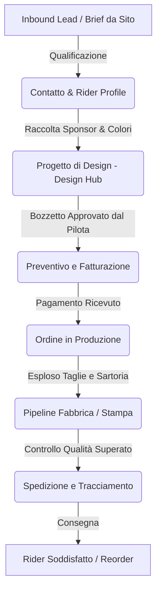

# 🏍️ BNXT CRM — Manuale Operativo Consolidato (Edizione BNXT)

## 1. Visione d'Insieme & Workflow Operativo
Il CRM BNXT connette l'acquisizione dei clienti sul sito web, la gestione dei design personalizzati, la produzione sartoriale ed il controllo qualità dell'abbigliamento motociclistico custom.

---

## 2. Ruoli Utente e Permessi (RBAC)
Il CRM struttura i permessi secondo le responsabilità operative:
1. **Amministratore / Manager (`admin` / `manager`):** Accesso completo a report finanziari, margini, configurazioni, utenti e fatturazione.
2. **Commerciale (`sales`):** Gestione lead, contatti, preventivi, ordini e comunicazioni con i clienti. Non accede ai design tecnici né alle configurazioni di fabbrica.
3. **Grafico / Designer (`designer`):** Gestione bozzetti (flat vector), asset grafici, sponsor e varianti nel Design Hub. Non visualizza dati contabili e preventivi.
4. **Responsabile Produzione (`production_manager`):** Pianificazione commesse, assegnazione stabilimenti e stato di avanzamento lotti.
5. **Operatore Fabbrica (`factory_operator`):** Ruolo specialistico ad alta protezione (vedi sezione successiva).
6. **Sola Lettura (`read_only`):** Consultazione schede senza permessi di scrittura e senza visibilità sui prezzi sensibili.

---

## 3. Direttiva di Sicurezza Fabbrica (Aggiornamento 3 Luglio 2026)
In ottemperanza alla specifica di isolamento fabbrica:
- **Sidebar Oscurata:** La barra laterale di navigazione viene completamente esclusa per gli operatori di fabbrica.
- **Isolamento Stabilimento:** L'operatore visualizza unicamente gli ordini assegnati al proprio stabilimento produttivo.
- **Nessuna Visibilità Prezzi:** Prezzi unitari, costi di produzione, margini e totali economici sono inaccessibili sia a livello di interfaccia che di query database (RLS).
- **Download Esclusivo:** L'operatore può espandere l'ordine e scaricare il singolo file grafico o l'intero archivio ZIP di commessa. È inibita qualsiasi operazione di upload, modifica o cancellazione.
- **Rotte di Atterraggio:** L'operatore atterra direttamente in `/design-hub` evitando reindirizzamenti su dashboard amministrative.

---

## 4. Gestione Comunicazioni Email & WhatsApp (Decisione 10 Settembre 2026)
*Stato: APPROVATO E VINCOLANTE (superata la vecchia direttiva di apertura diretta del 28 luglio 2026)*:
- **Modal Obbligatori:** Tutti i pulsanti di contatto (Email e WhatsApp) aprono obbligatoriamente il relativo modal interno di anteprima (`EmailPreviewModal` / `WhatsAppPreviewModal`).
- **Nessun Fallimento Silenzioso:** Se mancano dati essenziali (es. email o numero WhatsApp del destinatario), il modal segnala visivamente il campo mancante e disabilita l'invio fino al completamento.
- **Helper Unico di Apertura Esterna:** Qualsiasi chiamata al protocollo di sistema (`mailto:`, WhatsApp Web / API) transita rigorosamente dal modulo centralizzato `@/lib/open-external-url`.
- **Tracciamento Condizionale:** I registri di attività vengono scritti a database unicamente a fronte della conferma di invio/apertura da parte del comando nativo o browser.

---

## 5. Internazionalizzazione & Risoluzione Problemi
- Supporto multilingua nativo (Italiano / Inglese).
- Risoluzione anomalie di sessione tramite token refresh su Supabase Auth.
- Note di configurazione e credenziali operative configurate centralmente tramite vault delle chiavi applicative `[CONFIGURATO_IN_DISTRIBUZIONE]`.
