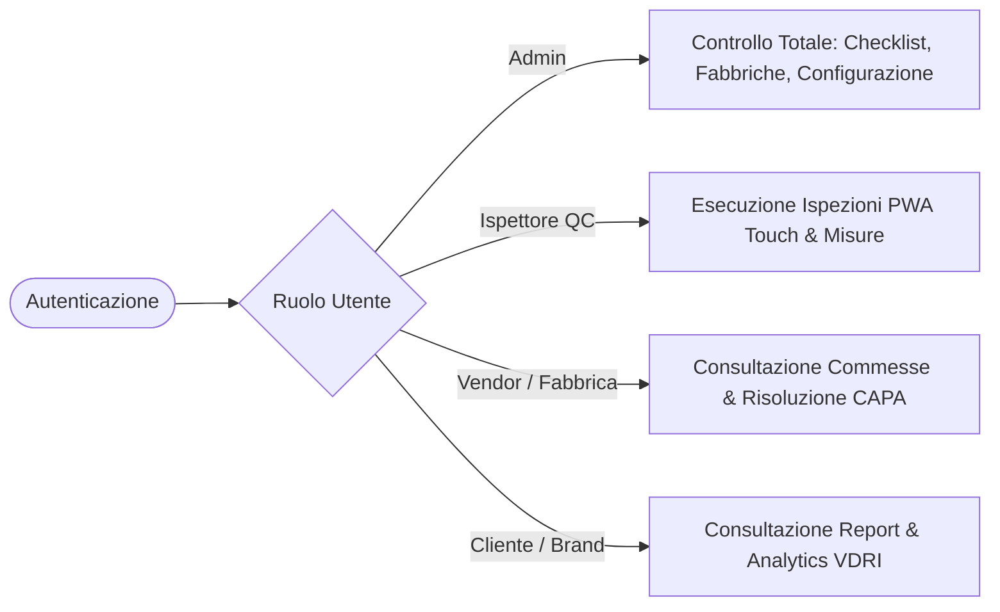

# 📋 DELPO QC — Manuale Operativo Completo (Edizione BNXT)

## 1. Architettura Generale e Modello di Accesso
DELPO QC è la piattaforma aziendale per il monitoraggio avanzato del controllo qualità, il campionamento statistico e la gestione delle non conformità industriali.

---

## 2. I Quattro Ruoli di Sistema
1. **Admin (Amministratore):** Gestisce impostazioni generali, librerie difetti, clienti (brand), stabilimenti produttivi, template di checklist e calcolo formule metriche.
2. **QC (Ispettore di Controllo Qualità):** Opera tramite interfaccia touch ottimizzata per tablet, esegue ispezioni sul campo, compila checklist, inserisce misurazioni dimensionali e allega evidenze fotografiche.
3. **Vendor (Fabbrica / Fornitore):** Visualizza i report d'ispezione emessi e gestisce la risposta alle azioni correttive (CAPA) entro i termini stabiliti.
4. **Cliente (Brand Proprietario):** Visualizza l'archivio report e gli analytics prestazionali sui propri ordini, inclusi indici di difettosità.

---

## 3. Workflow d'Ispezione e Motore AQL
- **Gestione Ordini (PO):** Assegnazione dell'ordine di acquisto allo stabilimento e al brand di riferimento.
- **Campionamento AQL (Acceptable Quality Limit):** Calcolo automatico della numerosità campionaria e delle soglie di accettabilità per difetti critici, maggiori e minori secondo standard ISO.
- **Checklist e Misurazioni:** Verifica passo-passo dei parametri di conformità e registrazione tolleranze.
- **Gestione Difetti ed Evidenze:** Classificazione del difetto con foto, descrizione e gravità.

---

## 4. Gestione CAPA (Corrective and Preventive Actions)
- Apertura automatica o manuale di una non conformità a fronte di esito negativo dell'ispezione.
- **Ecosistema Chiuso (Walled Garden):** DELPO non invia email transazionali esterne; tutte le notifiche di assegnazione e promemoria scadenze sono gestite all'interno della piattaforma per garantire la riservatezza e la sicurezza dei dati.
- Flusso di risoluzione: Presa in carico del fornitore ➔ Piano di contenimento ➔ Azione preventiva ➔ Validazione e chiusura a cura dell'Admin.

---

## 5. Analytics e Formula VDRI
- **VDRI (Vendor Defect Rate Index):** Indice pesato di affidabilità qualitativa calcolato per stabilimento e per fornitore su base temporale.
- **Report Standardizzati:** Generazione ed esportazione di report conformità in formato PDF ufficiale per gli stakeholder.

---

## 6. Riservatezza & Credenziali
Le credenziali di accesso per gli utenti di produzione sono configurate e distribuite unicamente attraverso canali sicuri aziendali `[CONFIGURATO_IN_DISTRIBUZIONE]`.
